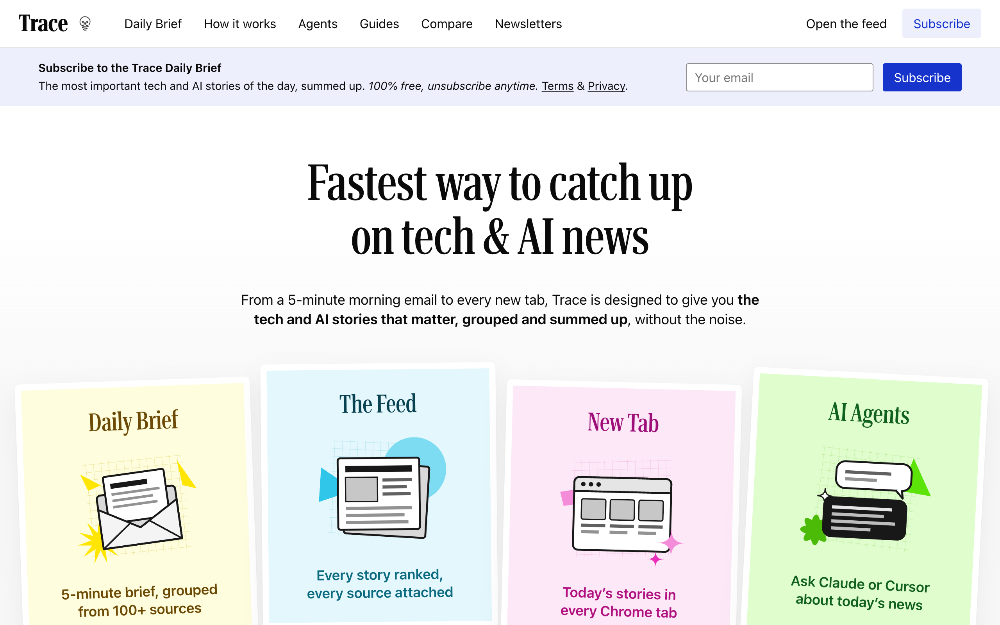
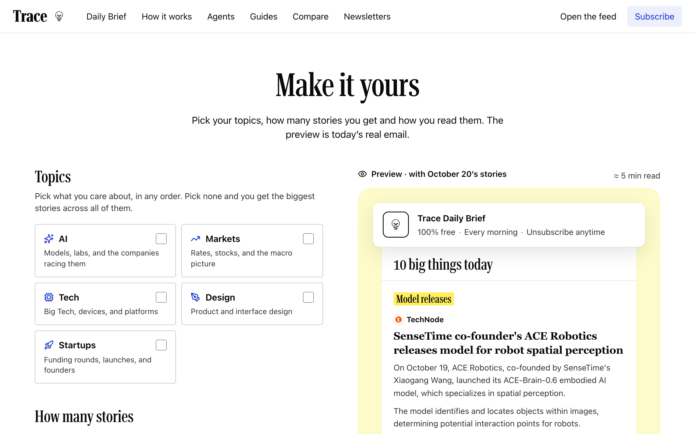

# Trace

**Trace reads the internet so you don't have to.** 100+ tech sources, 10
stories, 5 minutes. Free for everyone, open source.

Trace reads tech and AI news from over a hundred sources every morning, groups
the stories everyone is covering into one card, ranks them, and summarises each
one with every source attached. Read it in the feed, in a daily email you shape
yourself, on your phone, in every new Chrome tab, or through your AI assistant.

**Live:** [yourtrace.online](https://www.yourtrace.online) · **Daily archive:** [yourtrace.online/brief](https://www.yourtrace.online/brief) · **Build your brief:** [yourtrace.online/brief/customize](https://www.yourtrace.online/brief/customize)

<p align="center"></p>
<p align="center"></p>

## What you get

| | |
| --- | --- |
| **The feed** | One card per story, every source attached, ranked by how much it matters. Topic lanes (AI, Markets, Tech, Startups, Design), Top articles, bookmarks, an archive. |
| **The daily brief** | A morning email. Ten stories by default; each reader picks topics, 5/10/15 stories, and summaries, headlines only, or images. The preview in the builder is the real selection. |
| **Public archive** | Every edition at `/brief/YYYY-MM-DD`, with share buttons and its own share image. |
| **Mobile app** | Android app on Google Play; the Expo source lives in `trace/` in the main repo. |
| **New tab** | Chrome extension in [`trace-extension/`](trace-extension): the latest stories on every new tab. |
| **Agents** | Paste one URL into Claude, ChatGPT, Cursor, Claude Code, Codex or Gemini CLI, sign in with Google, and your agent reads the brief ([`/agents`](https://www.yourtrace.online/agents)). |

## Connect your AI agent

Trace is a read-only remote MCP server at `https://www.yourtrace.online/api/mcp`.
There is no key to copy: the first time your client connects it opens a Trace
page, you sign in with Google and click Allow. Connecting also sends you the
daily brief by email (unsubscribe any time; your agent keeps access).

```bash
claude mcp add --transport http trace https://www.yourtrace.online/api/mcp   # Claude Code
codex mcp add trace --url https://www.yourtrace.online/api/mcp               # Codex
gemini mcp add --transport http trace https://www.yourtrace.online/api/mcp   # Gemini CLI
```

In Claude and ChatGPT, add it as a custom connector; in Cursor and most other
clients, `{"mcpServers": {"trace": {"url": "https://www.yourtrace.online/api/mcp"}}}`.
Step-by-step for each app, a skill file for personal agents and header-based
Agent Keys for bots are on [`/agents`](https://www.yourtrace.online/agents).

Under the hood it follows the MCP authorization spec: OAuth 2.1 with PKCE,
protected resource and authorization server metadata under `/.well-known/`,
Client ID Metadata Documents or Dynamic Client Registration, one-hour access
tokens bound to `/api/mcp` and rotating refresh tokens. Only SHA-256 hashes of
codes and tokens are stored (`frontend/lib/oauth-*.ts`). A self-hosted
instance needs `oauth_clients,oauth_codes,oauth_tokens,oauth_grants` in
`LOCALDB_ALLOWED_COLLECTIONS` and `TRACE_OAUTH_ORIGIN` set to its public URL.

## How it works

```
 sources (RSS/Atom, HN, Reddit, Product Hunt, X, ...)      every ~20 min / ~3 h
        |
        v
 backend/v3  pipeline ── fetch → filter → group same-event coverage → rank
        |                └─ summarise each article once (cached), pick the brief
        v
 LocalDB (SQLite, Firestore-compatible API)  ◄── frontend/ (Next.js) ── readers
        |                                             trace/ (mobile), trace-extension/
        v
 daily email: own Postfix MTA + DKIM, or Brevo
```

- **Grouping.** Articles about the same event are merged into one story, so
  you see "1 story · 5 sources" instead of five near-identical links.
- **Ranking.** Coverage, source weight, recency and an LLM editor (OpenAI
  structured outputs) decide what makes the cut and what is worth an email. Model releases get their own slot.
- **Cost.** Summaries are cached per article, so LLM cost scales with the
  number of articles, not the number of readers.
- **The brief.** `backend/v3/flows/send_audience_newsletter.py` picks each
  reader's stories. `frontend/lib/newsletter-select.ts` is a line-for-line
  TypeScript port used by the live preview; a parity test keeps them identical.

## Repository layout

| Path | What |
| --- | --- |
| [`frontend/`](frontend) | Next.js web app: landing, feed, `/brief`, builder, account, API routes |
| [`backend/v3/`](backend/v3) | The pipeline: sources (`v3/config`), builders, ranking, summaries, scheduler, newsletter |
| [`backend/v1/`, `backend/v2/`](backend) | Shared modules the pipeline still uses (storage, email sending, templates, push notifications) |
| [`backend/localdb/`](backend/localdb) | Self-hosted SQLite document store with a Firestore-compatible client and HTTP server |
| [`backend/vps/`](backend/vps) | systemd units, Caddy example and backup script for a single-server deployment |
| [`trace/`](trace) | Mobile app (Expo / React Native); not yet in the public mirror |
| [`trace-extension/`](trace-extension) | Chrome new-tab extension (Manifest V3) |
| [`docker/`](docker), [`docker-compose.yml`](docker-compose.yml) | Self-hosting stack: LocalDB + pipeline + web app |
| [`docs/`](docs) | Screenshots and deployment notes |

## Run it yourself

### Docker (everything)

Prerequisites: Docker with Compose v2, an OpenAI API key, and a free Firebase
project (used for sign-in only).

Hardware: no GPU (the model calls go to the API). Rough guide, not yet measured
on a minimal Docker install:

| | |
| --- | --- |
| **Running** | 2 CPU cores, 2 GB RAM. The pipeline runs for a few minutes every 20 minutes; the database process idles around 400 MB. |
| **Building the web image** | 3–4 GB RAM for the Next.js build. On a small server, build on another machine and copy the image over. |
| **Disk** | A few GB. The hosted instance's database is under 1 GB after nine months. |

To drop a source you don't trust, remove it from the config in
`backend/v3/config/`: `trending_sources.json` for news (picked up on the next
20-minute run), `pulse_sources.json` for Tools and builds, or
`brief_sources.json` for blogs, subreddits and Top articles (both picked up on
the next 3-hourly pulse).

```bash
git clone <this repo> trace && cd trace
cp .env.example .env
# set at least:
#   OPENAI_API_KEY
#   LOCALDB_API_TOKEN            openssl rand -hex 32
#   TRACE_SESSION_SECRET         openssl rand -hex 32
#   FIREBASE_SERVICE_ACCOUNT_KEY single-line service-account JSON (Firebase Auth)
#   NEXT_PUBLIC_FIREBASE_*       your Firebase web app config
#   TRACE_APP_URL                public URL; email links are built from it
docker compose up --build
```

Web app on http://localhost:3000. The pipeline container builds the feed every
20 minutes (pulse every 3 hours) and publishes today's `/brief` edition without
emailing anyone. The feed is empty until the first run finishes (a few minutes).

### Piece by piece

The pipeline runs from `backend/`; LocalDB and the web app from the repo root.

```bash
# 1. LocalDB
export LOCALDB_API_TOKEN=... LOCALDB_ALLOWED_COLLECTIONS=...   # see .env.example
python3 -m backend.localdb.server --db data/localdb/documents.sqlite3 --port 8502

# 2. Pipeline
python3 -m venv .venv && .venv/bin/pip install -r backend/requirements.txt
cd backend
export TRACE_DB=local TRACE_LOCALDB_PATH=../data/localdb/documents.sqlite3
../.venv/bin/python -m v3.scheduler --jobs trending assemble --audience all --force-pools
../.venv/bin/python -m v3.flows.send_audience_newsletter --publish-only   # today's /brief
cd ..

# 3. Web app
cd frontend && npm install
FIRESTORE_BACKEND=local LOCALDB_URL=http://127.0.0.1:8502 LOCALDB_API_TOKEN=... npm run dev   # :5001
```

`python -m v3.scheduler --help` (from `backend/`) lists every job: `trending`,
`pulse`, `for_you`, `assemble`, `newsletter`, ...

### Mobile app and extension

- **Mobile:** `cd trace && npm install && npm run start` (Expo), where the
  app source is included. Point it at your web app's API in its config.
- **Extension:** open `chrome://extensions`, enable Developer mode, **Load
  unpacked** → `trace-extension/`. See [`trace-extension/README.md`](trace-extension/README.md).

### The daily email

```bash
cd backend
python -m v3.flows.send_audience_newsletter --dry-run    # who would get what
python -m v3.scheduler --jobs newsletter                  # build + send
```

- `EMAIL_TRANSPORT=smtp` sends through a local MTA (Postfix on `127.0.0.1:25`),
  DKIM-signed with `EMAIL_DKIM_*`. Publish SPF, DKIM and DMARC for your domain.
- `EMAIL_TRANSPORT=brevo` uses the Brevo API; `auto` uses the MTA first and
  Brevo for the buckets/domains you list.
- Readers fall into `member` (daily), `winback` (dormant: at most 3 emails, 4
  days apart, opt-in with `NEWSLETTER_WINBACK=1`, Brevo only) and `landing`
  (email-only signups). A dormant reader who opens the feed signed in, or
  clicks through from any of the emails, becomes a `member` the next morning.

Every variable is documented in [`.env.example`](.env.example).

## Add a news source

Sources are plain JSON in [`backend/v3/config/`](backend/v3/config):

| File | Feeds |
| --- | --- |
| `trending_sources.json` | The main trending feed (plus Hacker News / discovery settings) |
| `pulse_sources.json`, `brief_sources.json` | Developer pulse and brief (RSS, HN, Reddit, ...) |
| `for_you_sources.json`, `deep_dive_sources.json` | Interest-matched and long-form feeds |

```json
{
  "interest_id": "tech",
  "name": "The Verge",
  "url": "https://www.theverge.com/rss/index.xml",
  "type": "atom",
  "exclude_title_keywords": ["deal", "review"],
  "source_weight": 1.2
}
```

`type` is `rss`, `atom`, `html` or `ai_tldr`; `source_weight` boosts or dampens
a source in ranking. Check a source before you open a PR:

```bash
cd backend && python -m v3.audit_sources --config v3/config/trending_sources.json --source "The Verge"
```

Not sure? Open a [news source request](.github/ISSUE_TEMPLATE/source_request.md).

## Contributing

Pull requests are welcome: new sources, ranking and summary quality,
self-hosting, docs, bug fixes. Read [CONTRIBUTING.md](CONTRIBUTING.md) for
setup and the checks CI runs. Security issues: [SECURITY.md](SECURITY.md).

## Known limitations

- Sign-in uses Firebase Authentication even when storage is LocalDB.
  Replacing it is a good contribution.
- Some defaults point at the hosted site: set `TRACE_APP_URL`,
  `EMAIL_SENDER_*`, `EMAIL_DKIM_*`, `EMAIL_REPLY_TO` and
  `NEXT_PUBLIC_CONTACT_EMAIL` for your deployment. Blog posts and SEO copy in
  `frontend/` describe the hosted site; edit them freely.

## Support Trace

Trace is free, with one clearly labelled sponsored tool. If it saves you time,
[buy me a coffee](https://buymeacoffee.com/taratdev) or use the **Sponsor**
button on this repo. Stars, bug reports and new sources help just as much.

## License

[GNU AGPL-3.0](LICENSE). If you run a modified version as a network service,
make your modified source available to its users.
