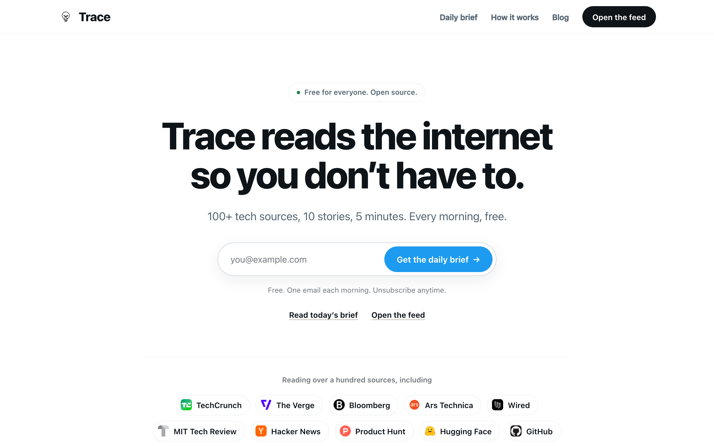
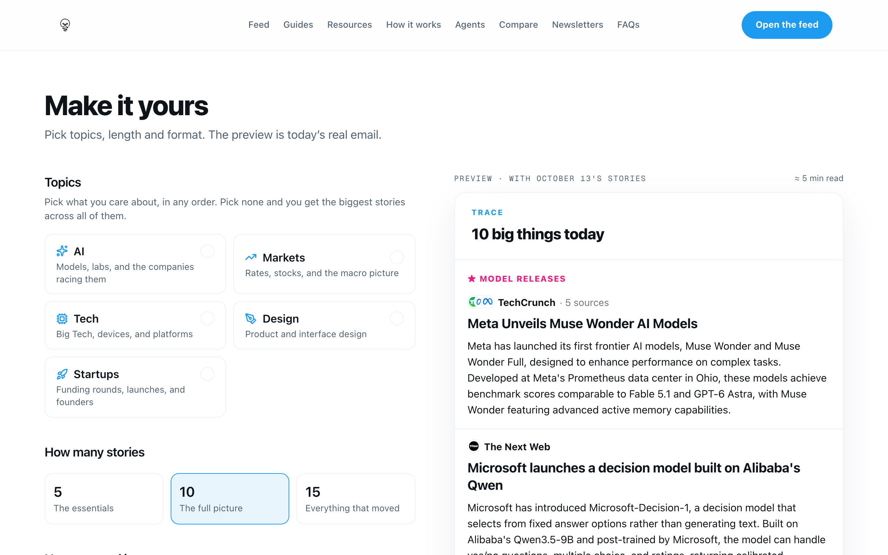

# Trace

**Trace reads the internet so you don't have to.** 100+ tech sources, 10
stories, 5 minutes. A free, open-source daily tech and AI brief: one shared
trending feed, AI summaries with every source attached, and a morning email
each reader can shape.

Hosted version: **https://yourtrace.online** · Public archive: **https://yourtrace.online/brief**

<p align="center"></p>
<p align="center"></p>

## What it does

- **Shared trending feed.** A pipeline pulls stories from RSS/Atom feeds, Hacker
  News, Reddit, Product Hunt and more, groups duplicate coverage of the same
  event, ranks them and publishes one feed for everyone.
- **AI summaries cached per article.** Each article is summarised once and the
  result is cached, so LLM cost scales with the number of *articles*, not the
  number of *users*.
- **Daily email brief.** Ten stories by default. Each reader picks topics, 5, 10
  or 15 stories, and summaries, headlines only, or images. Sent through your
  own Postfix MTA with DKIM, or through Brevo.
- **Public archive.** Every edition lives at `/brief/YYYY-MM-DD` with share
  buttons and its own share image.
- **Self-hostable.** Storage can be a single SQLite file (LocalDB) that speaks a
  Firestore-compatible API, so you do not need a Firestore database to run it.

## Architecture

```
            timer (every ~20 min / ~3 h)
                     |
         +-----------v-----------+
         |  Pipeline (v3/)       |  RSS / HN / Reddit / Product Hunt / ...
         |  trending, pulse,     |  OpenAI: grouping, ranking, summaries
         |  assemble, newsletter |
         +-----------+-----------+
                     | Firestore-style reads/writes
         +-----------v-----------+        +----------------------+
         |  LocalDB (SQLite)     |<-------|  Next.js web app     |
         |  backend/localdb      |  HTTP  |  frontend/           |
         +-----------------------+ bearer +----------+-----------+
                     ^                               | Firebase Auth
                     |                               v  (sign-in)
         +-----------+-----------+
         |  Email (v1/tools)     |-->  own Postfix MTA + DKIM   or   Brevo API
         +-----------------------+
```

| Path | What |
| --- | --- |
| `frontend/` | Next.js app (feed, landing, account, API routes) |
| `v3/` | The pipeline: source config (`v3/config`), builders, scorer, summariser, scheduler, newsletter send |
| `v1/`, `v2/` | The few legacy modules the pipeline still imports (storage layer, email senders, templates, unified newsletter builder) |
| `backend/localdb/` | Self-hosted SQLite document store with a Firestore-compatible client + HTTP server |
| `backend/vps/` | Example systemd units, Caddyfile and backup script for a single-VPS deployment |

## Quickstart (Docker Compose)

Prerequisites: Docker with Compose v2, an OpenAI API key, and a Firebase
project (for sign-in only - see "Known limitations").

```bash
git clone <this repo> trace && cd trace
cp .env.example .env
# edit .env: set at least
#   OPENAI_API_KEY
#   LOCALDB_API_TOKEN        (openssl rand -hex 32)
#   TRACE_SESSION_SECRET     (openssl rand -hex 32)
#   FIREBASE_SERVICE_ACCOUNT_KEY  (single-line service-account JSON, for Firebase Auth)
#   NEXT_PUBLIC_FIREBASE_*        (your Firebase web app config)
#   TRACE_APP_URL                 (public URL; email links are built from it)
docker compose up --build
```

- Web app: http://localhost:3000
- LocalDB API: http://localhost:8502 (bearer token required)
- The `pipeline` container runs the trending job every 20 minutes and the pulse
  job every 3 hours (`TRENDING_INTERVAL_SECONDS` / `PULSE_INTERVAL_SECONDS`).
  Each run also publishes today's public edition (`/brief`, the landing
  sample, the builder preview) without emailing anyone. The feed is empty
  until the first run finishes (a few minutes).

### Without Docker

```bash
# 1. LocalDB
export LOCALDB_API_TOKEN=... LOCALDB_ALLOWED_COLLECTIONS=...   # see .env.example
python3 -m backend.localdb.server --db data/localdb/documents.sqlite3 --host 127.0.0.1 --port 8502

# 2. Pipeline
python3 -m venv .venv && .venv/bin/pip install -r requirements.txt
export TRACE_DB=local TRACE_LOCALDB_PATH=data/localdb/documents.sqlite3 OPENAI_API_KEY=...
.venv/bin/python -m v3.scheduler --jobs trending assemble --audience all --force-pools

# 3. Web app
cd frontend && npm install
FIRESTORE_BACKEND=local LOCALDB_URL=http://127.0.0.1:8502 LOCALDB_API_TOKEN=... npm run dev   # :5001
```

Run `python3 -m v3.scheduler --help` for every job (`trending`, `pulse`,
`for_you`, `assemble`, `newsletter`, ...). For a real server, `backend/vps/`
contains systemd units/timers and a Caddy reverse-proxy example.

### Public daily archive and newsletter builder

- **`/brief` and `/brief/YYYY-MM-DD`** - a public archive of each day's edition,
  stored in the `daily_editions` collection. Publish without sending anything:
  `python -m v3.flows.send_audience_newsletter --publish-only`.
- **`/brief/customize`** - a newsletter builder: pick topics, 5/10/15 stories, and
  whether to include summaries, headlines and images, with a live preview.
  `frontend/lib/newsletter-select.ts` is a TypeScript port of the pipeline's
  `_select_from_groups`; `v3/test_newsletter_parity.py` checks the two stay in sync.
- **Audience buckets.** Each send run splits readers into `member` (daily),
  `winback` (dormant readers; at most 3 emails, 4 days apart) and `landing`
  (email-only signups). Win-back only runs when `NEWSLETTER_WINBACK=1` and
  `winback` is in `EMAIL_BREVO_BUCKETS` (it deliberately never sends cold mail
  from your own MTA).

### Daily email

```bash
python3 -m v3.scheduler --jobs newsletter          # build + send
```

- `EMAIL_TRANSPORT=smtp` (default): sends through a local MTA (Postfix on
  `127.0.0.1:25`), DKIM-signed with `EMAIL_DKIM_*`. You must publish SPF, DKIM
  and DMARC DNS records for your sending domain.
- `EMAIL_TRANSPORT=brevo`: uses the Brevo API (`BREVO_API_KEY`, `EMAIL_SENDER_BREVO`).
- `EMAIL_TRANSPORT=auto`: MTA first, Brevo for configured buckets/domains and as fallback.

## Environment variables

Derived from the code (`os.getenv` / `process.env`). The authoritative,
commented list is [`.env.example`](.env.example).

**Required**

| Variable | Used by | Purpose |
| --- | --- | --- |
| `OPENAI_API_KEY` | pipeline, frontend | Summaries, grouping, ranking, newsletter copy, chat |
| `LOCALDB_API_TOKEN` | localdb, frontend | Shared bearer token |
| `LOCALDB_ALLOWED_COLLECTIONS` | localdb | Root collections the server exposes (compose has a default). Must include `daily_editions`, `email_sends`, `email_events` |
| `LOCALDB_URL` | frontend | LocalDB base URL |
| `FIRESTORE_BACKEND` | frontend | `local` to use LocalDB (`firebase` default, `fallback`) |
| `TRACE_DB` / `TRACE_LOCALDB_PATH` | pipeline | `local` + path to the SQLite file (`firebase` default, `dual`) |
| `TRACE_SESSION_SECRET` | frontend | Signs session cookies |
| `FIREBASE_SERVICE_ACCOUNT_KEY` or `_PATH` | frontend | Firebase Admin (Auth) |
| `NEXT_PUBLIC_FIREBASE_*` | frontend (build) | Firebase web config for sign-in |
| `TRACE_APP_URL` | pipeline | Public URL of the web app; every email link uses it |

**Optional**

| Variable | Purpose |
| --- | --- |
| `LOCALDB_PATH`, `LOCALDB_HOST`, `LOCALDB_PORT` | LocalDB server file/bind (defaults `localdb.sqlite3`, `127.0.0.1`, `8500`) |
| `NEWSLETTER_WRITE_MODEL`, `NEWSLETTER_PICK_MODEL`, `HEADLINE_MODEL`, `HOME_BRIEFING_MODEL`, `TRENDING_GROUP_EMBED_MODEL` | Model overrides |
| `TYPESAFE_API_KEY`, `TYPESAFE_GROUPING_MODEL`, `TYPESAFE_RANKING_MODEL`, `NEWSLETTER_JEV_BATCH` | Optional external quality judge; skipped if unset |
| `EXA_API_KEY` | Extra article content lookup |
| `FIRECRAWL_URL` | Coverage enrichment (default `http://localhost:3002`) |
| `PRODUCT_HUNT_API_KEY`, `PRODUCT_HUNT_API_SECRET` | Product Hunt in the pulse feed |
| `X_API_BEARER_TOKEN` / `TWITTER_BEARER_TOKEN` | X/Twitter curated sources |
| `EMAIL_TRANSPORT`, `EMAIL_SMTP_HOST/PORT/TIMEOUT`, `EMAIL_SENDER_LOCAL`, `EMAIL_SENDER_NAME`, `EMAIL_REPLY_TO` | Email routing and identity |
| `EMAIL_DKIM`, `EMAIL_DKIM_DOMAIN`, `EMAIL_DKIM_SELECTOR`, `EMAIL_DKIM_KEY` | DKIM signing (defaults point at the hosted instance - override them) |
| `BREVO_API_KEY`, `EMAIL_SENDER_BREVO`, `EMAIL_SENDER_BREVO_NAME`, `EMAIL_BREVO_BUCKETS` (comma list of `member`, `winback`, `landing`), `EMAIL_BREVO_DOMAINS` | Brevo transport |
| `EMAIL_TRACKING`, `NEWSLETTER_WAIT_MINUTES` | Link tracking / send delay |
| `NEWSLETTER_WINBACK`, `NEWSLETTER_WINBACK_DAILY_CAP` | Win-back emails to dormant readers: set `NEWSLETTER_WINBACK=1` **and** list `winback` in `EMAIL_BREVO_BUCKETS` or the run is skipped (cap default 250/day) |
| `NEXT_PUBLIC_CONTACT_EMAIL` | Contact/support address on contact, privacy, terms, delete-account pages |
| `NEXT_PUBLIC_GITHUB_REPO_URL` | Your repo; the "Open source" links stay hidden until it is set |
| `FIREBASE_SERVICE_ACCOUNT_JSON/_PATH`, `FIREBASE_PROJECT_ID`, `FIREBASE_STORAGE_BUCKET` | Pipeline Firestore mode / storage bucket |
| `NEXT_PUBLIC_APP_URL`, `NEXT_PUBLIC_SITE_URL` | Public URLs (build-time) |
| `NEXT_PUBLIC_POSTHOG_KEY`, `NEXT_PUBLIC_POSTHOG_HOST`, `POSTHOG_PERSONAL_API_KEY` | Analytics |
| `TRACE_CONTROL_PLANE_*`, `INSTAGRAM_*`, `POSTIZ_*`, `CAROUSEL_API_KEY`, `GITHUB_*`, `DODO_*` | Maintainer-only admin/social features and sponsored-tool payments; leave unset |

## Adding news sources

Sources are plain JSON in `v3/config/`:

| File | Feeds |
| --- | --- |
| `trending_sources.json` | The shared trending feed (`sources[]`, plus Hacker News/discovery settings) |
| `pulse_sources.json`, `brief_sources.json` | Developer pulse / brief (RSS, HN, Reddit, ...) |
| `for_you_sources.json`, `deep_dive_sources.json` | Interest-matched and long-form feeds |

A trending source looks like:

```json
{
  "interest_id": "tech",
  "name": "The Verge",
  "url": "https://www.theverge.com/rss/index.xml",
  "type": "atom",
  "exclude_title_keywords": ["deal", "review"],
  "source_weight": 1.2
}
```

`type` is one of `rss`, `atom`, `html`, `ai_tldr`. `source_weight` boosts or
dampens a source in ranking. Check a source before committing it:

```bash
python3 -m v3.audit_sources --config v3/config/trending_sources.json --source "The Verge"
```

## Known limitations

- **Sign-in uses Firebase Authentication** even when storage is LocalDB. You
  need a (free-tier) Firebase project: set the `NEXT_PUBLIC_FIREBASE_*` web
  config and Admin credentials in `.env`. Removing this dependency is a good
  contribution.
- Some defaults still point at the hosted instance: set `TRACE_APP_URL`,
  `EMAIL_SENDER_*`, `EMAIL_DKIM_*`, `EMAIL_REPLY_TO` and
  `NEXT_PUBLIC_CONTACT_EMAIL` for your deployment. Marketing copy, blog posts
  and SEO metadata in `frontend/` describe the hosted site; edit them freely.

## Contributing

See [CONTRIBUTING.md](CONTRIBUTING.md). New sources, summary-quality fixes and
self-hosting docs are especially welcome.

## Support Trace

Trace is free and has no ads beyond one clearly labelled sponsored tool. If it
saves you time, you can [buy me a coffee](https://buymeacoffee.com/taratdev)
or use the **Sponsor** button on this repo. Stars, bug reports and new sources
help just as much.

## License

[GNU AGPL-3.0](LICENSE). If you run a modified version as a network service you
must make your modified source available to its users.
